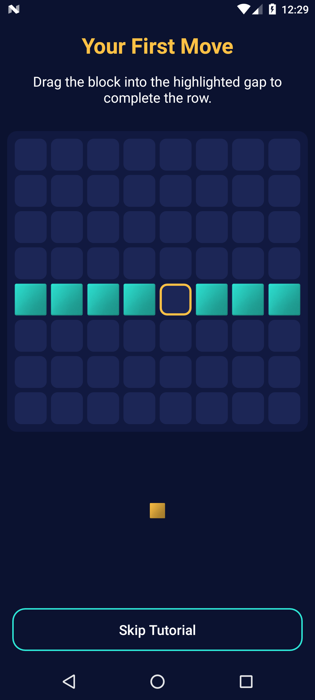
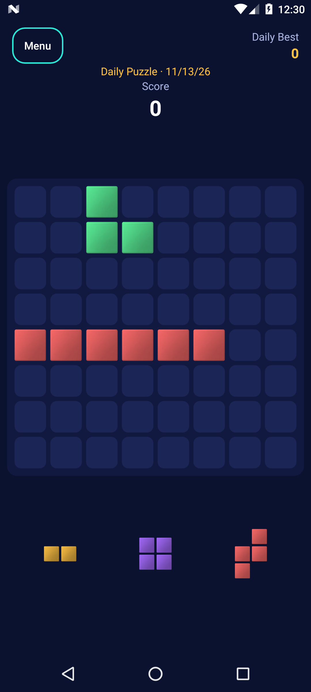

# Blast Block

[Türkçe](#türkçe) · [English](#english)

<p align="center">
  
  
</p>

---

## Türkçe

Blast Block, Android için çevrimdışı bir blok bulmaca oyunudur. Parçaları 8×8 tahtaya sürükleyin, dolu satır ve sütunları temizleyin ve kombolarla rekorunuzu kırın.

### Kurulum

[Releases](https://github.com/alpha32k/BlastBlock/releases/latest) sayfasından deneme APK’sını Android 7.0 veya üzeri bir cihaza indirin ve açın.

### Özellikler

- **Klasik oyun:** Menüye dönünce oyun kendiliğinden kaydedilir. Aynı düğme, kayıt varsa devam eder, yoksa yeni oyun açar.
- **Günlük bulmaca:** Aynı UTC gününde herkes aynı tahta ve parçalarla oynar. Günün rekoru cihazda saklanır.
- **Geçmiş:** Bitirilen klasik oyunlar ve günlük denemeler tarihleriyle birlikte puana göre sıralanır.
- **İlk hamle öğreticisi:** İlk oyunda işaretli boşluğa bir blok sürükleyerek satır temizlemeyi öğrenin.
- **Dil ve ayarlar:** Türkçe ve İngilizce arayüz. Ses ve titreşim ana menüden ayrı ayrı açılıp kapatılabilir.

### Kaynaktan derleme

Projeyi Android Studio’da açıp **Run** ile çalıştırabilir veya Android SDK ve JDK 17 ile aşağıdaki komutları kullanabilirsiniz.

```powershell
.\gradlew.bat test
.\gradlew.bat assembleDebug
```

APK, `app/build/outputs/apk/debug/` klasörüne yazılır. Java projesi üç modülden oluşur: `app` arayüz, `domain` oyun kuralları, `data` kayıtlar ve ayarlar.

### Belgeler

- [Oyun kuralları ve proje açıklaması](docs/PROJE_ACIKLAMASI.md)
- [Mimari](docs/MIMARI.md)
- [Derleme ve kurulum rehberi](docs/DERLEME_VE_KURULUM.md)

### Lisans

Bu proje [MIT Lisansı](LICENSE) ile yayımlanır.

---

## English

Blast Block is an offline block puzzle game for Android. Drag pieces onto an 8×8 board, clear full rows and columns, and beat your best score with combos.

### Installation

Download and open the test APK from [Releases](https://github.com/alpha32k/BlastBlock/releases/latest) on a device running Android 7.0 or newer.

### Features

- **Classic:** Returning to the menu saves your game automatically. One button resumes your save or starts a new game if there is no save.
- **Daily puzzle:** Everyone gets the same board and pieces on the same UTC day. Your daily best is stored on the device.
- **History:** Finished classic and daily runs are ranked by score with their completion dates.
- **First move tutorial:** Learn how to clear a row by dragging a block into the highlighted gap.
- **Language and settings:** Turkish and English interface. Sound and vibration have separate toggles in the main menu.

### Building from source

Open the project in Android Studio and select **Run**, or use the Android SDK and JDK 17 with the following commands.

```powershell
.\gradlew.bat test
.\gradlew.bat assembleDebug
```

The APK is written to `app/build/outputs/apk/debug/`. The Java project has three modules: `app` for the UI, `domain` for the game rules, and `data` for saves and settings.

### Documents

- [Game rules and project overview (Turkish)](docs/PROJE_ACIKLAMASI.md)
- [Architecture (Turkish)](docs/MIMARI.md)
- [Build and installation guide (Turkish)](docs/DERLEME_VE_KURULUM.md)

### License

This project is released under the [MIT License](LICENSE).
